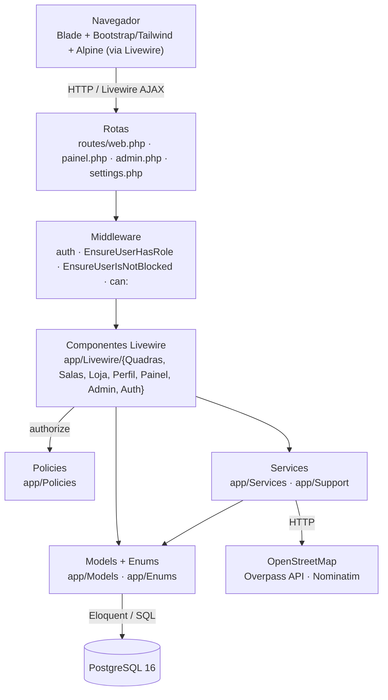
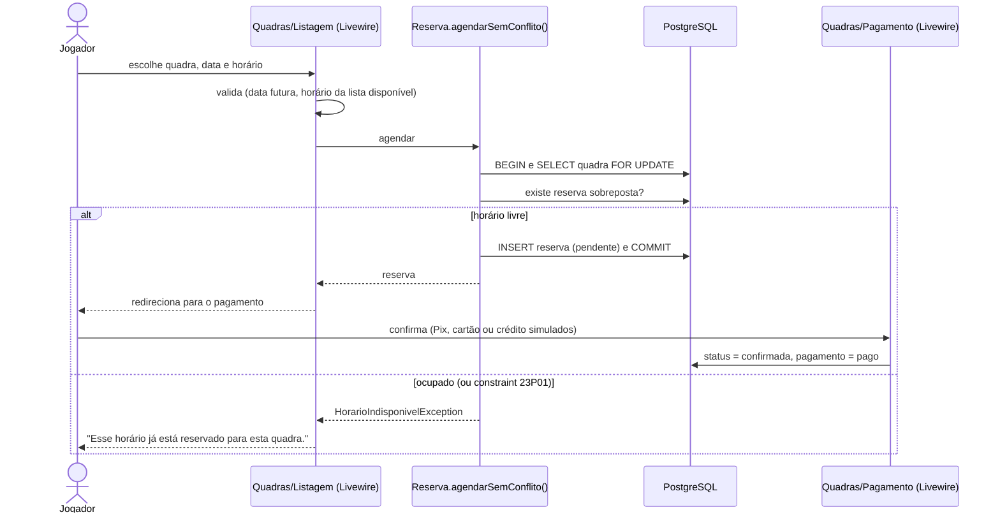

# Arquitetura

O AlugaQuadra é um monólito Laravel renderizado no servidor. Não há API REST
separada: as telas são componentes **Livewire**, que recebem as ações do
navegador (cliques, envios de formulário) por requisições AJAX e devolvem o HTML
atualizado.

## Camadas

## Papéis de cada camada

**Rotas e middleware.** As rotas são separadas por público: o site e a área do
jogador ficam em `web.php`, o painel do dono em `painel.php` (prefixo `/painel`,
middleware `role:dono_quadra`), a administração em `admin.php` (`role:admin`) e
as configurações de conta em `settings.php`. O middleware `EnsureUserHasRole`
barra o papel errado e `EnsureUserIsNotBlocked` desloga contas bloqueadas pelo
administrador.

**Componentes Livewire.** Cada página é um componente de página inteira, que faz
o papel de controlador (recebe a ação, valida, chama o model) e de *view*
(`resources/views/livewire/...`). As regras de validação ficam no próprio
componente, com regras compartilhadas em `app/Concerns` e `app/Rules`
(`CpfValido`, `CnpjValido`).

**Policies.** Decidem quem pode fazer o quê com cada registro: o dono só edita
as próprias quadras (`QuadraPolicy`), só o organizador gerencia a sala
(`SalaPolicy`), só o comprador vê a confirmação do pedido e comprador ou
vendedor veem a nota (`PedidoPolicy`). São chamadas com `$this->authorize()` nos
componentes ou com `->can()` nas rotas.

**Models e regras de negócio.** As regras que precisam ser atômicas ficam nos
models, dentro de transações:

- `Reserva::agendarSemConflito()` trava a quadra, verifica o horário e grava a
  reserva. A *exclusion constraint* do banco é a última barreira.
- `Sala::entrarComo()` e `Sala::aprovarPedido()` travam a sala e recontam as
  vagas antes de incluir um jogador.
- O snapshot da comissão é gravado no `saving` da `Reserva`, na primeira vez em
  que ela fica confirmada e paga.

**Services.** Encapsulam integrações e operações que não pertencem a um único
model:

| Service | Faz |
|---|---|
| `Overpass\OverpassQuadraFinder` | Busca quadras esportivas ao redor de uma coordenada no OpenStreetMap, com cache, *retry* e timeout. |
| `Geocoding\NominatimClient` | Converte o endereço de uma quadra em latitude/longitude. |
| `Aprovacao\CadastroAprovacaoService` | Máquina de estados da aprovação de donos e quadras, com histórico. |
| `Privacidade\ExportadorDeDadosPessoais` | Monta o JSON do "Baixar meus dados" (LGPD). |
| `Support\Carrinho` | Carrinho da loja guardado na sessão. |

**Enums.** Todo valor de domínio é um *enum* PHP com rótulo em português
(`ReservaStatus`, `Esporte`, `UserRole`, `StatusCadastro`...), o que evita
strings soltas no código e documenta os estados possíveis.

## Fluxo de uma reserva

## Por que estas tecnologias

- **Laravel + Livewire:** um único projeto e uma única linguagem para back e
  front, com validação, autorização e testes no mesmo lugar. Para o escopo de um
  TCC, evita manter uma API e uma SPA sincronizadas.
- **Fortify:** autenticação pronta e testada (login com limite de tentativas,
  recuperação de senha, autenticação em dois fatores), sem telas impostas. As
  telas são do próprio projeto.
- **PostgreSQL:** permite expressar a regra "sem reservas sobrepostas" no
  próprio banco (*exclusion constraint*), além de tipos como `json` e `time`.
- **Pest:** sintaxe enxuta para testes de feature, que são a maior parte da
  suíte (ver [testes.md](testes.md)).
