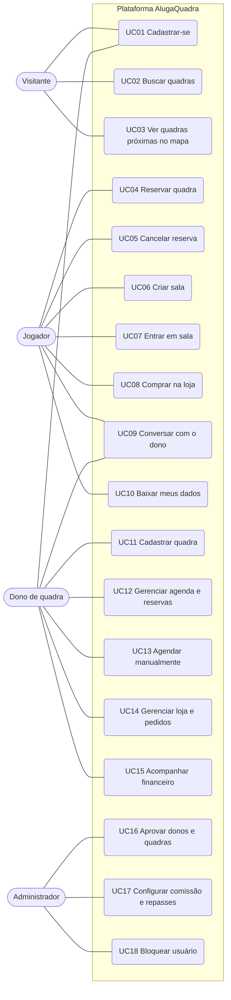

# Casos de uso

Atores: **Visitante** (sem login), **Jogador**, **Dono de quadra** e
**Administrador**. O Jogador herda tudo o que o Visitante faz. O Mermaid não tem
diagrama UML de casos de uso, então o diagrama abaixo usa um fluxograma com os
atores à esquerda.

## Descrições

### UC01 — Cadastrar-se
- **Ator:** Visitante.
- **Fluxo principal (jogador, `/registro`):** informa nome, e-mail, CPF,
  nascimento, sexo, endereço, telefone e senha; aceita a Política de
  Privacidade e os Termos; a conta é criada e o usuário já entra logado.
- **Fluxo principal (dono, `/cadastro-dono`):** informa pessoa física ou
  jurídica (CPF ou CNPJ), estabelecimento, endereço, documento de identidade e
  dados de recebimento Pix; aceita a comissão e os termos; a conta fica
  **pendente** de aprovação (UC16).
- **Alternativos:** CPF/CNPJ com dígito verificador inválido; e-mail, CPF ou
  CNPJ já cadastrado; UF inexistente; jogador com menos de 16 anos; termos não
  aceitos. Em todos, a conta não é criada e o campo mostra o erro.

### UC02 — Buscar quadras
- **Ator:** Visitante ou Jogador.
- **Fluxo principal:** em `/quadras`, filtra por cidade, nome, esporte e
  cobertura; ao escolher uma quadra, vê os horários livres da data escolhida.
- **Regra:** só aparecem quadras **aprovadas** pelo administrador.

### UC03 — Ver quadras próximas no mapa
- **Ator:** Visitante ou Jogador.
- **Fluxo principal:** em `/quadras-proximas`, o navegador informa a
  localização (com permissão do usuário) e o sistema consulta a Overpass API
  (OpenStreetMap) por quadras num raio escolhido.
- **Alternativo:** a Overpass não responde; a tela mostra um aviso e permite
  tentar de novo.

### UC04 — Reservar quadra
- **Ator:** Jogador.
- **Pré-condição:** estar logado; quadra aprovada e dono sem pausa ativa.
- **Fluxo principal:** escolhe data e horário livre; o sistema cria a reserva
  **pendente** e leva ao pagamento simulado (Pix, cartão ou créditos); ao pagar,
  a reserva fica **confirmada**.
- **Alternativo — horário em conflito:** se outro jogador reservou o mesmo
  horário entre a escolha e a confirmação, a reserva é recusada com "Esse
  horário já está reservado para esta quadra." A garantia vem da trava na
  transação e da *exclusion constraint* no banco.

### UC05 — Cancelar reserva
- **Ator:** Jogador.
- **Pré-condição:** reserva própria, futura e não cancelada.
- **Fluxo principal:** em Minhas Reservas, cancela. Reserva ainda pendente
  (não paga) cancela direto. Reserva confirmada exige escolher o reembolso:
  crédito na plataforma (o valor volta ao saldo) ou estorno.
- **Alternativo:** reserva confirmada a menos do prazo definido pelo dono
  (padrão de 5h) do início não pode ser cancelada; a mensagem informa o prazo.

### UC06 — Criar sala
- **Ator:** Jogador.
- **Fluxo principal:** escolhe esporte, nível, data, horário, duração, número
  de vagas, privacidade e tipo de aprovação; o sistema mostra as quadras livres
  e, ao confirmar, grava **numa única transação** a reserva da quadra e a sala.
  O criador segue para o pagamento da sua parte.
- **Alternativo:** a quadra deixa de estar livre no meio do processo; nada é
  gravado e aparece "Essa quadra não está mais disponível nesse horário."

### UC07 — Entrar em sala
- **Ator:** Jogador.
- **Fluxo principal (aprovação automática):** paga a sua parte e entra.
- **Fluxo principal (aprovação manual):** envia um pedido; o organizador aprova
  ou recusa na página da sala.
- **Alternativos:** sala cheia (inclusive quando a última vaga é tomada por
  outra pessoa no mesmo instante: a sala é travada e as vagas são recontadas);
  sala fechada; pedido já recusado. O organizador não consegue aprovar pedido
  com a sala cheia.

### UC08 — Comprar na loja
- **Ator:** Jogador.
- **Fluxo principal:** adiciona produtos ao carrinho e finaliza; é gerado um
  pedido por estabelecimento, com número de retirada, e o dono é notificado.
  Comprador e vendedor podem abrir a nota de compra.
- **Alternativo:** o estoque acaba antes da finalização; nenhum pedido é criado
  e o carrinho é ajustado com um aviso.

### UC09 — Conversar com o dono
- **Atores:** Jogador e Dono.
- **Fluxo principal:** a partir de uma quadra ou de um pedido da loja, o
  jogador abre uma conversa; o dono responde em Mensagens do painel.

### UC10 — Baixar meus dados
- **Ator:** Jogador (ou qualquer usuário logado).
- **Fluxo principal:** em Editar Perfil, clica em "Baixar meus dados" e recebe
  um JSON com cadastro, endereço, reservas, pedidos, salas, cartões (mascarados)
  e metadados de documentos. Ver [lgpd.md](lgpd.md).

### UC11 — Cadastrar quadra
- **Ator:** Dono.
- **Fluxo principal:** informa dados, endereço (geocodificado pelo Nominatim),
  fotos e comprovante do imóvel; a quadra entra na fila de aprovação.
- **Alternativo:** editar campos sensíveis de uma quadra aprovada a devolve
  para análise.

### UC12 — Gerenciar agenda e reservas
- **Ator:** Dono.
- **Fluxo principal:** vê a agenda do dia ou da semana e a lista de reservas
  por aba (pendentes, confirmadas, concluídas, canceladas); confirma ou cancela.
  Define horário de funcionamento, exceções de data e pausa temporária.

### UC13 — Agendar manualmente
- **Ator:** Dono.
- **Fluxo principal:** registra uma reserva para um cliente com conta ou sem
  conta (nome e telefone), com status de pagamento e valor.
- **Alternativo:** horário ocupado; mesma proteção de UC04.

### UC14 — Gerenciar loja e pedidos
- **Ator:** Dono.
- **Fluxo principal:** cadastra produtos com preço e estoque; acompanha os
  pedidos e marca a retirada.

### UC15 — Acompanhar financeiro
- **Ator:** Dono.
- **Fluxo principal:** vê o faturamento por período e por quadra, já com a
  comissão da plataforma descontada, e os repasses recebidos.

### UC16 — Aprovar donos e quadras
- **Ator:** Administrador.
- **Fluxo principal:** na fila de aprovação, abre o cadastro, confere o
  documento e o checklist e aprova, rejeita (com motivo) ou pede ajustes. Cada
  passo fica no histórico.

### UC17 — Configurar comissão e repasses
- **Ator:** Administrador.
- **Fluxo principal:** define o percentual de comissão, que vale só para
  reservas futuras, e registra os repasses feitos aos donos.

### UC18 — Bloquear usuário
- **Ator:** Administrador.
- **Fluxo principal:** bloqueia um dono; na próxima requisição, a sessão dele é
  encerrada.
