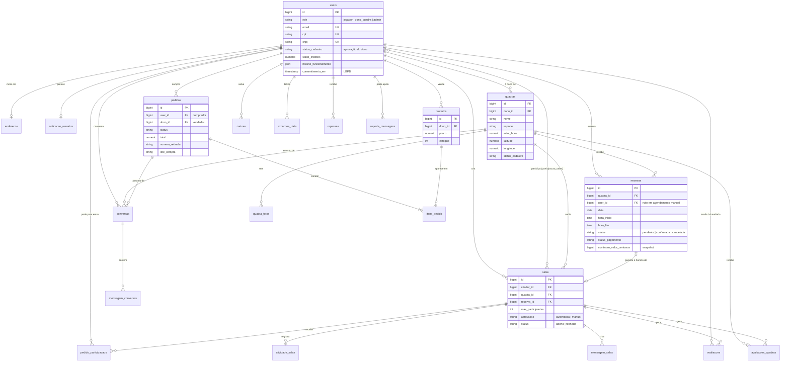

# Modelo de dados

Banco PostgreSQL 16. As tabelas são criadas pelas migrations em
`database/migrations/` e cada uma tem um model em `app/Models/`. Valores de
domínio (status, esporte, papel...) são `string` no banco e *enums* PHP em
`app/Enums/`. Setup e credenciais estão em [banco-de-dados.md](banco-de-dados.md).

## Diagrama entidade-relacionamento

Tabelas de domínio. Ficam de fora as de infraestrutura do Laravel (`sessions`,
`cache`, `jobs`, `password_reset_tokens`, `notifications`).

Duas relações polimórficas não aparecem no diagrama:

- `documentos` (`documentavel_type`, `documentavel_id`): documento de
  identidade de um **usuário** dono ou comprovante de imóvel de uma **quadra**.
- `cadastro_historicos` (`avaliavel_type`, `avaliavel_id`): cada mudança de
  status na aprovação de um dono ou de uma quadra, com o administrador que a fez.

## Entidades

| Tabela | O que guarda |
|---|---|
| `users` | Jogadores, donos de quadra e administradores na mesma tabela, separados por `role` (ver [banco-de-dados.md](banco-de-dados.md)). Donos têm também estabelecimento, horário de funcionamento, chave Pix e status de aprovação. |
| `enderecos` | Endereço do usuário, 1:1 (`user_id` único). |
| `noticacao_usuarios` | Preferências de notificação, 1:1 com o usuário. |
| `quadras` | Quadra anunciada por um dono: endereço, coordenadas, esporte, piso, valor por hora, amenidades e status de aprovação. |
| `quadra_fotos` | Fotos da quadra, com moderação (`status_moderacao`). |
| `excecoes_data` | Dias em que o dono fecha ou muda o horário (feriados, manutenção). |
| `reservas` | Horário reservado numa quadra. Guarda o *snapshot* da comissão no momento do pagamento, para mudanças de percentual não alterarem o passado. |
| `salas` | Partida aberta para completar time, ligada à reserva que garante o horário. |
| `participacao_salas` | Quem está na sala e como pagou a sua parte (tabela pivô). |
| `pedido_participacaos` | Pedidos de entrada em salas com aprovação manual. |
| `atividade_salas`, `mensagem_salas` | Linha do tempo e chat da sala. |
| `avaliacoes`, `avaliacoes_quadras` | Avaliações entre jogadores e da quadra, depois da partida. |
| `produtos`, `pedidos`, `itens_pedido` | Loja: produtos de cada dono, pedidos (um por dono vendedor, agrupados por `lote_compra`) e itens. |
| `conversas`, `mensagem_conversas` | Chat entre jogador e dono, sobre uma quadra ou um pedido da loja. |
| `cartoes` | Cartões salvos (só titular, bandeira, 4 últimos dígitos e validade). |
| `comissao_configuracoes` | Histórico do percentual de comissão definido pelo administrador. |
| `repasses` | Valores repassados pela plataforma a cada dono. |
| `documentos`, `cadastro_historicos` | Documentos enviados e histórico da aprovação de cadastros. |
| `suporte_mensagens` | Mensagens enviadas pela página de Ajuda. |

## Regras de integridade no banco

- **Reservas não se sobrepõem.** A *exclusion constraint*
  `reservas_sem_sobreposicao` (migration `2026_10_19_120000`) usa a extensão
  `btree_gist` para impedir que duas reservas não canceladas da mesma quadra
  tenham faixas de horário que se cruzam. O intervalo é `[início, fim)`: uma
  reserva que termina às 20:00 não conflita com outra que começa às 20:00.
- **Unicidade:** e-mail, CPF e CNPJ por usuário; um endereço e um registro de
  preferências por usuário.
- **Exclusão em cascata:** apagar um usuário apaga as quadras, reservas,
  pedidos, salas criadas e mensagens dele. Onde o histórico de terceiros
  importa, a chave vira nula (`nullOnDelete`): `pedidos.dono_id`,
  `produtos.dono_id`, `salas.reserva_id`, `atividade_salas.user_id`.
- **Estoque:** o checkout baixa o estoque com `UPDATE ... WHERE estoque >= qtd`
  dentro da transação do pedido; se alguma linha não for afetada, o pedido
  inteiro é desfeito.
